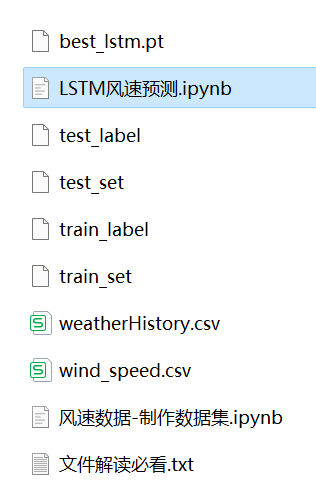
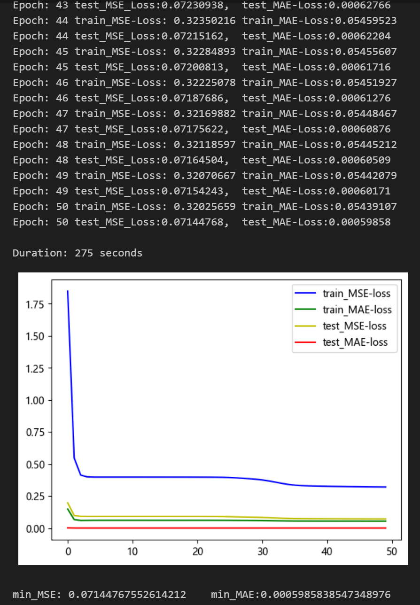
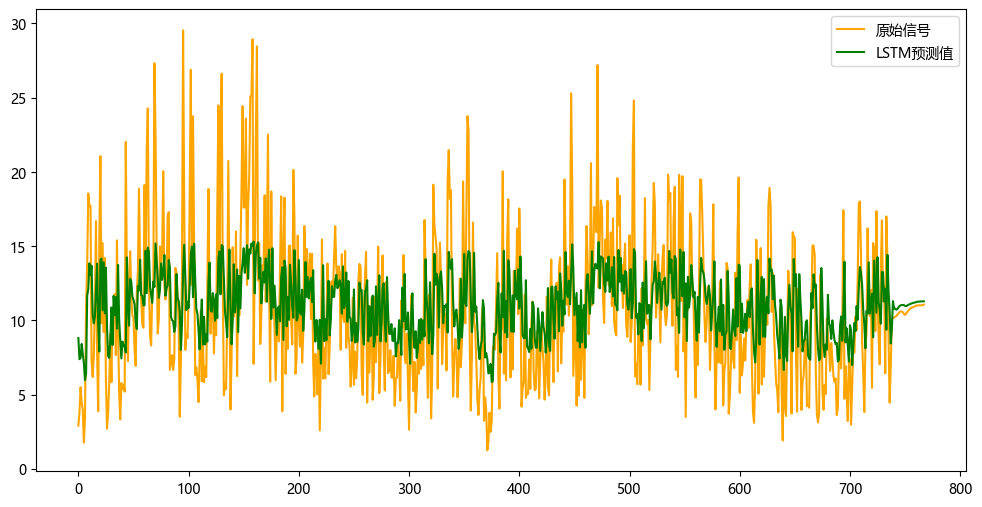

# Stepwise Prediction Model (Part 1) - LSTM

Multi-feature variables include the following:
Include wind speed data, as well as pre-generated and ready-made wind speed dataset and label set, all of which can be run.
Include code for data preprocessing and complete LSTM model prediction.
Environment: Python 3.9

## Images

<!-- PAYMENT_BLOCK -->

## Get this dataset

- Payment link (Stripe): [Buy now](https://buy.stripe.com/3cs8yP7sY87d0vu9AB)
- Payment QR code: 

<!-- /PAYMENT_BLOCK -->
